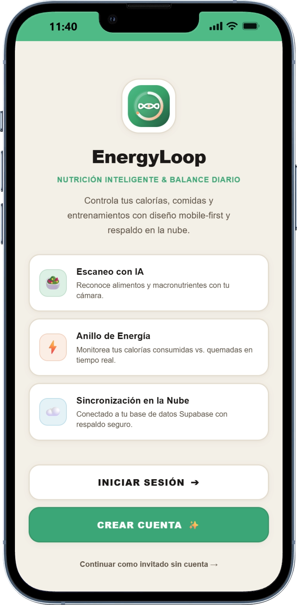

<div align="center">

  

  <h1>⚡ EnergyLoop</h1>
  <p><strong>Plataforma Inteligente de Nutrición, Balance Energético y Fitness de Alto Rendimiento</strong></p>

  <p>
    <a href="#-acerca-de-energyloop">Acerca de</a> •
    <a href="#-capturas-de-pantalla">Galería</a> •
    <a href="#-características-principales">Características</a> •
    <a href="#-stack-tecnológico">Tecnología</a> •
    <a href="#-pilares-de-experiencia">Experiencia</a> •
    <a href="#-instalación-y-configuración">Instalación</a>
  </p>

  <div>
    
    
    
    
    
    
  </div>

  <br />
</div>

---

## 🌟 Acerca de EnergyLoop

**EnergyLoop** transforma la gestión de la nutrición y el entrenamiento físico mediante una interfaz vanguardista y asistencia de Inteligencia Artificial. Diseñada bajo los estándares visuales de **Porsche Design System**, la plataforma ofrece una visión completa, precisa y elegante del ciclo de energía corporal diario.

Permite a los usuarios tomar control total sobre sus objetivos metabólicos, registrar comidas mediante visión computacional, monitorear la hidratación y analizar la evolución de sus entrenamientos en tiempo real.

---

## 📱 Capturas de Pantalla

<div align="center">
  <table align="center" width="100%">
    <tr>
      <td align="center" width="50%">
        <br />
        <sub><b>Inicio & Bienvenida</b></sub>
      </td>
      <td align="center" width="50%">
        <br />
        <sub><b>Dashboard & Balance Calórico</b></sub>
      </td>
    </tr>
    <tr>
      <td align="center" width="50%">
        <br />
        <sub><b>Historial & Métricas Semanales</b></sub>
      </td>
      <td align="center" width="50%">
        <br />
        <sub><b>Ajustes & Metas Nutricionales</b></sub>
      </td>
    </tr>
    <tr>
      <td align="center" width="50%">
        <br />
        <sub><b>Asistente TMB (Wizard)</b></sub>
      </td>
      <td align="center" width="50%">
        <br />
        <sub><b>Cálculo del Plan Metabólico</b></sub>
      </td>
    </tr>
    <tr>
      <td align="center" width="50%">
        <br />
        <sub><b>Registro de Comidas (Selección)</b></sub>
      </td>
      <td align="center" width="50%">
        <br />
        <sub><b>Porciones y Macronutrientes</b></sub>
      </td>
    </tr>
    <tr>
      <td align="center" colspan="2">
        <br />
        <sub><b>Registro de Ejercicios & Quema Calórica</b></sub>
      </td>
    </tr>
  </table>
</div>

---

## 🔥 Características Principales

### 📸 Escáner de Nutrición Inteligente con IA
* **Reconocimiento Visual:** Analiza fotos de platillos e identifica automáticamente ingredientes, porciones y desglose nutricional gracias a **Google Gemini AI**.
* **Lectura Instantánea:** Clasificación automática de calorías y macronutrientes sin necesidad de búsqueda manual constante.

### ⚖️ Balance Energético Dinámico
* **Análisis Ingerido vs. Quemado:** Cálculo automatizado del déficit o superávit calórico diario.
* **Calorie Ring:** Indicador circular interactivo con microanimaciones para un progreso visual inmediato.

### 🥩 Control de Macronutrientes e Hidratación
* **Objetivos Personalizados:** Barras de progreso en tiempo real para Proteínas, Carbohidratos y Grasas.
* **Seguimiento de Hidratación:** Registro rápido de consumo de agua diario con metas personalizables según el perfil biológico.

### 🏋️ Registro de Entrenamientos y Actividad
* **Gastos Calóricos:** Seguimiento de sesiones de ejercicio, calorías quemadas y minutos activos.
* **Biblioteca Integrada:** Clasificación por intensidad y tipo de ejercicio con cálculo automático de impacto energético.

### 📈 Analítica e Historial Avanzado
* **Métricas Semanales:** Gráficos intuitivos para evaluar consistencia, promedios calóricos y hábitos de consumo a lo largo del tiempo.
* **Filtros Históricos:** Navegación por fechas y registros detallados día por día.

---

## 🛠️ Stack Tecnológico

| Capa | Tecnología | Descripción |
| :--- | :--- | :--- |
| **Frontend UI** | `React 19` + `TypeScript` | Arquitectura modular, moderna y con tipado estricto. |
| **Diseño & Estilos** | `Porsche Design System` + `TailwindCSS v4` | Componentes de nivel enterprise con estética minimalista y deportiva. |
| **Animaciones** | `GSAP` (`GreenSock`) | Transiciones fluidas entre pantallas y animaciones de contador en tiempo real. |
| **Inteligencia Artificial** | `Google Gemini AI` (`@google/generative-ai`) | Procesamiento multimodal para análisis automático de alimentos. |
| **Backend & Base de Datos** | `Supabase` | Persistencia en la nube, sincronización en tiempo real y autenticación. |
| **Build Tool** | `Vite 8` | Entorno de desarrollo ultra rápido y bundling optimizado. |

---

## 💎 Pilares de Experiencia

* **Diseño Premium & Moderno:** Interfaz pulida con soporte nativo para **Modo Oscuro** y **Modo Claro**, cuidando cada detalle tipográfico y espacial.
* **Feedback Háptico Visual:** Respuestas dinámicas ante cada interacción mediante componentes interactivos y animaciones fluidas.
* **Precisión Biométrica:** Ajustes personalizados basados en TMB (Tasa Metabólica Basal) y nivel de actividad física del usuario.

---

## 🚀 Instalación y Configuración

Sigue estos pasos para ejecutar el proyecto en tu entorno local:

### 📋 Prerrequisitos

* [Node.js](https://nodejs.org/) (versión 18.0 o superior recomendada)
* [pnpm](https://pnpm.io/) (`npm install -g pnpm`)

### 1. Clonar el Repositorio

```bash
git clone https://github.com/tu-usuario/EnergyLoop-FitApp.git
cd EnergyLoop-FitApp
```

### 2. Instalar Dependencias

```bash
pnpm install
```

### 3. Configurar Variables de Entorno

Copia el archivo de plantilla `.env.example` para crear tu `.env` local:

```bash
cp .env.example .env
```
*(En Windows PowerShell puedes usar `Copy-Item .env.example .env`)*

Luego, abre el archivo `.env` y completa tus credenciales:

```env
# Conexión con Supabase
VITE_SUPABASE_URL=https://tu-proyecto.supabase.co
VITE_SUPABASE_PUBLISHABLE_KEY=tu-supabase-publishable-key

# API de Google Gemini (Visión y Reconocimiento de Alimentos con IA)
VITE_GEMINI_API_KEY=tu-gemini-api-key
```

> **Nota:**
> * Puedes obtener las credenciales de Supabase creando un proyecto en [Supabase](https://supabase.com).
> * La clave de Google Gemini se obtiene en [Google AI Studio](https://aistudio.google.com/).

### 4. Ejecutar la Aplicación

Inicia el entorno de desarrollo local con Vite:

```bash
pnpm dev
```

Abre tu navegador en la URL indicada en consola (usualmente `http://localhost:5173`).

---

### 📜 Scripts Disponibles

| Comando | Descripción |
| :--- | :--- |
| `pnpm dev` | Inicia el servidor de desarrollo en tiempo real. |
| `pnpm build` | Chequea tipos TypeScript y compila la app optimizada para producción. |
| `pnpm preview` | Previsualiza el build de producción en un servidor local. |
| `pnpm lint` | Ejecuta ESLint para verificar buenas prácticas y estilo de código. |

---

<div align="center">
  <sub>Diseñado con pasión por la salud, la tecnología de vanguardia y el diseño de alto rendimiento.</sub>
</div>
